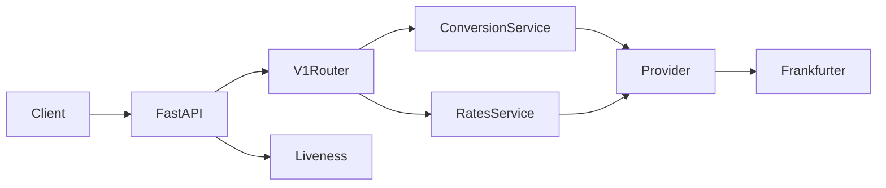

# Architecture

## Runtime overview

The running application is a FastAPI process. At startup it creates one shared
HTTPX client, constructs the configured exchange-rate provider, and stores the
provider and conversion/rates services in application state. At shutdown it
closes the HTTP client.

The public request flow is:

The V1 router currently mounts conversion, rates, and currencies endpoints.
`/health/live` is mounted directly by the app. The root router does not include
a V2 router.

## Implemented boundaries

### Application and routing

- `app/main.py` creates the FastAPI application, configures CORS when explicit
  origins are supplied, registers application and request-validation
  exception handlers, creates shared provider services, and mounts liveness.
- `app/api/router.py` mounts V1 using the configured `API_V1_PREFIX`.
- `app/api/v1/router.py` includes the conversion, rates, and currencies
  endpoint routers.
- FastAPI docs and OpenAPI are enabled except when `APP_ENV=production`.

### Conversion and rates

The conversion service retrieves a rate for the requested source and target,
uses `Decimal` arithmetic, and rounds the result with the target currency's
configured precision. Same-currency conversions use a rate of one and do not
call the provider.

The rates service validates and normalizes provider data for latest,
historical, and time-series operations. Historical dates and time-series end
dates cannot be in the future. Date ranges must be ordered.

### Provider integration

`FrankfurterProvider` implements the provider interface and uses the shared
HTTPX client created during application startup. It derives latest,
historical, and time-series URLs from `EXCHANGE_API`, validates response
structure and rates, and retries timeouts, connection errors, HTTP 429, and
HTTP 5xx responses up to `EXCHANGE_MAX_RETRIES` times after the initial
attempt. Retry delays are bounded exponential delays without jitter.

The default timeout is five seconds. No automatic alternative-provider
fallback is configured.

### Optional supporting modules

The repository includes SQLAlchemy models and repositories, Alembic
migrations, API-key services and routes, usage/quota logic, rate-limit
middleware and storage, an in-memory cache, freshness evaluation, metrics
helpers, health-check helpers, and deployment manifests.

These are not all wired into the public app startup or router. In particular:

- API-key routes are not included in the root router, and authentication
  middleware/dependencies are not applied to the mounted API.
- Rate-limit middleware is not added to the ASGI app.
- The rates service calls the provider directly; its cache and freshness
  helpers are not integrated into those endpoint operations.
- Database and Redis clients are not initialized by the application lifespan.
- `/health/ready` and `/metrics` routes are not registered.
- Request-ID and security-header middleware modules are not registered.

Configuration settings and infrastructure containers do not activate these
features by themselves.

## Data and failure semantics

Provider dates represent the observation date supplied by Frankfurter. They
are distinct from the time the application fetched the response. A failed
provider call is surfaced as an application error; the currently mounted
rates/conversion path does not fall back to cached or persisted rates.

Conversion values and rates are represented as decimals in application
schemas. The provider integration receives numeric JSON values and the
service normalizes them before returning API response models.

## Testing and deployment

Tests are organized under `tests/` by unit, integration, API, security,
end-to-end, and load-test concerns. CI installs optional database, Redis, and
observability dependencies, starts PostgreSQL and Redis services, runs
migrations, and executes the test suite on Python 3.11 and 3.12.

The Docker image packages the API with its optional database, Redis, and
observability Python dependencies and runs as a non-root user. Compose and
Kubernetes manifests provide supporting infrastructure and probes; readiness
and metrics probes should not be treated as operationally active until their
corresponding application routes are mounted.
